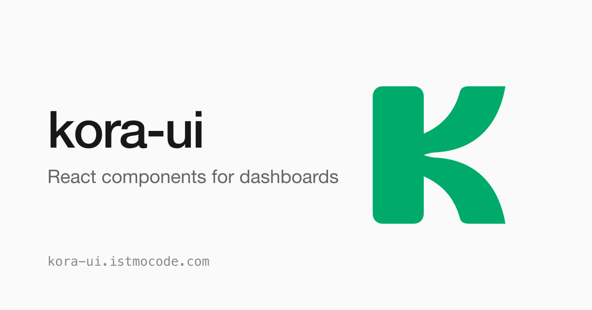

<p align="center">
  <a href="https://kora-ui.istmocode.com"></a>
</p>

<p align="center">
  <a href="https://www.npmjs.com/package/kora-ui"></a>
  <a href="https://www.npmjs.com/package/kora-ui"></a>
  <a href="https://www.npmjs.com/package/kora-ui"></a>
  <a href="https://github.com/isaacavilap/kora-ui/actions/workflows/ci.yml"></a>
  <a href="LICENSE"></a>
</p>

<p align="center">
  <a href="https://kora-ui.istmocode.com/docs"><b>Get started</b></a> ·
  <a href="https://kora-ui.istmocode.com/components">Components</a> ·
  <a href="https://kora-ui.istmocode.com/templates">Templates</a> ·
  <a href="https://www.npmjs.com/package/kora-ui">npm</a>
</p>

React components for building admin and analytics dashboards: layout, data tables, charts, and ready-made sign-in, settings, and error screens. Everything works on phones and desktops, in light and dark.

- **Phones and desktops** without extra props. The sidebar becomes a drawer, table rows become cards, and dialogs rise from the bottom.
- **Your brand** through CSS variables, with separate light and dark token sets.
- **No Tailwind required.** You import one stylesheet. Tailwind projects get their own CSS layer.
- **Loads only what you use.** Tables, charts, auth, and screens are separate entry points.
- **Spanish and English** labels built in.
- **Accessible.** It is built on Radix primitives.

## Install

```bash
npm install kora-ui
```

```tsx
import "kora-ui/styles.css";
import { Grid, KpiCard } from "kora-ui";

export default function Overview() {
  return (
    <Grid>
      <KpiCard label="Revenue" value="$84,300" delta={7.3} deltaLabel="vs last month" />
      <KpiCard label="Orders" value="1,204" delta={2.1} deltaLabel="vs last month" />
    </Grid>
  );
}
```

React 18 or 19 is required. The [package README](packages/kora-ui/README.md) has the full component list, every entry point, theming, Tailwind setup, and examples for the app frame, tables, charts, and sign-in screens.

Or start from the base project, which comes with Next.js, the menu, sign-in screens, and sample pages ready to run:

```bash
npx degit isaacavilap/kora-starter my-app
```

## What's in this repository

| Path | What it is | Published as |
|---|---|---|
| [`packages/kora-ui`](packages/kora-ui) | The component library | [`kora-ui`](https://www.npmjs.com/package/kora-ui) |
| [`packages/kora-ui-mcp`](packages/kora-ui-mcp) | MCP server that gives AI assistants (Claude, ChatGPT, Gemini, Codex) the real components and props | [`kora-ui-mcp`](https://www.npmjs.com/package/kora-ui-mcp) |
| [`apps/docs`](apps/docs) | The docs site, with live demos of every component and full-page templates | [kora-ui.istmocode.com](https://kora-ui.istmocode.com) |
| [`packages/kora-ui-sketch`](packages/kora-ui-sketch) | Sketch (boceto) system: lo-fi wireframes as JSON, with an editor and AI generation | Internal |

## Develop

Node 24 (see `.nvmrc`).

```bash
npm install
npm run build:lib       # Build kora-ui and kora-ui-mcp
npm run dev:docs        # Docs at http://localhost:3000
npm run dev:lib         # Rebuild the library on every change
npm test                # Unit tests for every workspace
npm run check:tags      # Demos and templates use kora-ui components, not native tags
```

`npm run dev:lib` rebuilds JS and CSS on every change in `packages/kora-ui/src`. It also copies `dist` into the local apps that install the library with `file:`, so their `next dev` reloads by itself. The list of those apps is in `scripts/sync-consumers.mjs`.

**Sketches.** `packages/kora-ui-sketch` is the only sketch system. The Istmo Code portal shows the same one in its proposals, and the portal embeds this folder through its `scripts/build.mjs`. Run it with `npm run dev:sketch` (http://localhost:3461). Its format and components are in [packages/kora-ui-sketch/README.md](packages/kora-ui-sketch/README.md).

## Versions

Releases follow [semantic versioning](https://semver.org), and `kora-ui` and `kora-ui-mcp` share one version. How to add a changeset and cut a release: [VERSIONING.md](VERSIONING.md). The list of versions is on [GitHub Releases](https://github.com/isaacavilap/kora-ui/releases).

## License

[MIT](LICENSE) © Isaac Avila
